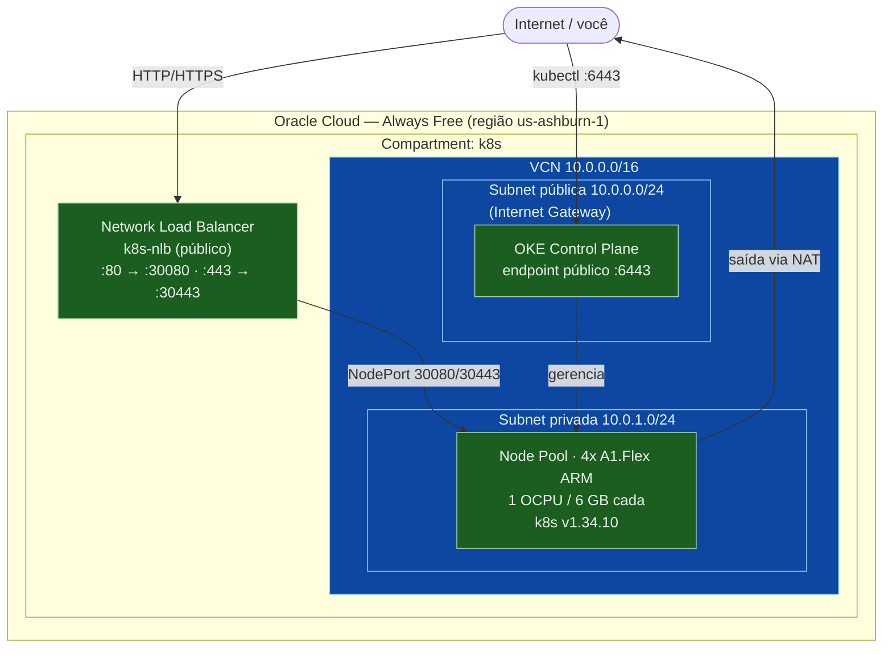
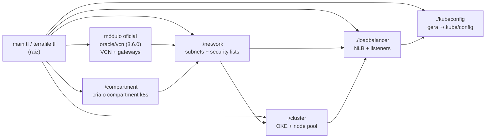

# oke-free — Cluster Kubernetes do Juan na Oracle Cloud (Always Free)

Cluster [OKE](https://www.oracle.com/cloud/cloud-native/container-engine-kubernetes/) (Oracle Kubernetes Engine) rodando **100% dentro do Always Free tier** da OCI, provisionado com Terraform/OpenTofu.

> Este projeto começou como um material de comunidade (`#MêsDoKubernetes` do LinuxTips, por [@Raphael Borges](https://r11s.com.br/)). Foi adaptado para uso pessoal do Juan: state remoto no S3, imagens de worker atualizadas, rede mais fechada e documentação própria. O crédito da base original é dele.

---

## O que roda aqui (resumo)

| Recurso | Valor | Observação |
| --- | --- | --- |
| Shape dos nós | `VM.Standard.A1.Flex` (ARM/aarch64) | **Único shape gratuito compatível com OKE — não trocar** |
| Nós | 4 | `node_size` |
| CPU / RAM por nó | 1 OCPU / 6 GB | total 4 OCPU / 24 GB = teto exato do Always Free A1 |
| Control plane | `v1.34.10` | `k8s_version` |
| Imagem do worker | `Oracle-Linux-8.10-aarch64-2026.09.18-0-OKE-1.34.10-1923` | atualizada 2026-10-30 |
| Região | `us-ashburn-1` | `region` |
| Exposição | Network Load Balancer (NLB) nas portas 80/443 | gratuito no Always Free |
| State | **S3 `oke-tf-state`** (`us-east-1`) | ver [State remoto](#state-remoto-s3) |

Tudo acima são `default`s em [`variables.tf`](variables.tf) — mexer num lugar só muda o cluster.

---

## Mapa do repositório (para não se perder)

O repositório tem **duas camadas** com ferramentas diferentes. A regra de ouro:

> **Recurso da OCI** (cluster, rede, NLB, nós) → **Terraform** (`*.tf` e pastas de módulo).
> **Coisa que roda dentro do Kubernetes** (apps, add-ons) → **ArgoCD** (`infra/`, `apps/`, `charts/`).

### Onde mexo para fazer X?

| Quero... | Edite | Como aplica |
| --- | --- | --- |
| Trocar versão do Kubernetes ou imagem dos nós | [`variables.tf`](variables.tf) | `terraform apply` (depois ciclar os nós, ver [Atualizar a imagem](#atualizar-a-imagem-do-worker-patches-de-segurança)) |
| Mudar rede, NLB, nº de nós | `network/`, `loadbalancer/`, `variables.tf` | `terraform apply` |
| Publicar versão nova do escalafacil | [`charts/escala-servir/values-prod.yaml`](charts/escala-servir/values-prod.yaml) (`image.tag`) | merge na `master` → ArgoCD |
| Mudar o tududi (config, recursos, backup) | [`apps/tududi/`](apps/tududi/) | merge na `master` → ArgoCD |
| Instalar/atualizar um add-on (ingress, cert-manager, Prometheus...) | [`infra/argocd-apps/`](infra/argocd-apps/) | merge na `master` → ArgoCD |
| Mudar memória/CPU do próprio ArgoCD | [`argocd/values.yml`](argocd/values.yml) | merge na `master` → ArgoCD |
| Adicionar um app novo | um `Application` novo em `infra/argocd-apps/` | merge na `master` → ArgoCD |

### Por pasta

| Pasta / arquivo | Para que serve | Gerenciado por |
| --- | --- | --- |
| [`variables.tf`](variables.tf) | **Painel de controle do cluster:** versão do k8s, imagem dos nós, nº de nós, CPU/RAM, portas. Quase tudo que você muda na infra está aqui. | Terraform |
| [`terrafile.tf`](terrafile.tf) | Liga os módulos entre si (compartment → VCN → rede → cluster → NLB → kubeconfig) e define os `output`s. | Terraform |
| [`main.tf`](main.tf) | Versões exigidas do Terraform e dos providers. | Terraform |
| [`backend.tf`](backend.tf) | Guarda o state no bucket S3 `oke-tf-state`. | Terraform |
| [`compartment/`](compartment/) | Módulo: cria o compartment `k8s` na OCI. | Terraform |
| [`network/`](network/) | Módulo: sub-redes pública/privada e *security lists* (firewall). | Terraform |
| [`cluster/`](cluster/) | Módulo: o cluster OKE e o *node pool* (os 4 nós A1). | Terraform |
| [`loadbalancer/`](loadbalancer/) | Módulo: o Network Load Balancer (portas 80/443 → NodePort 30080/30443 dos nós). | Terraform |
| [`kubeconfig/`](kubeconfig/) | Módulo: gera o `~/.kube/config` ao final do apply. | Terraform |
| [`infra/argocd-apps/`](infra/argocd-apps/) | **O índice de tudo que roda no cluster:** um `Application` do ArgoCD por arquivo (ArgoCD, ingress-nginx, cert-manager, metrics-server, Prometheus/Grafana, tududi, escalafacil, baofeng). O `root-app.yaml` observa esta pasta. | ArgoCD |
| [`infra/README.md`](infra/README.md) | Como adotar algo já instalado, como remover um app com segurança, bootstrap de um cluster novo. | — |
| [`apps/tududi/`](apps/tududi/) | Manifestos do tududi (Deployment, Service, Ingress, NetworkPolicy, Litestream). [`BACKUP.md`](apps/tududi/BACKUP.md) explica backup e restore. | ArgoCD |
| [`apps/monitoring/`](apps/monitoring/) | Só documentação: como acessar Grafana/Prometheus. A instalação está em `infra/argocd-apps/kube-prometheus-stack.yaml`. | — |
| [`charts/escala-servir/`](charts/escala-servir/) | Chart Helm do escalafacil. **`values-prod.yaml` é o único arquivo que você edita** no dia a dia. | ArgoCD |
| [`argocd/values.yml`](argocd/values.yml) | Valores do Helm do próprio ArgoCD (recursos, domínio, ingress). | ArgoCD (self-managed) |
| [`gateway/`](gateway/) | ⚠️ **Nome enganoso:** vem de quando se usava Envoy Gateway; hoje o ingress é o nginx. Guarda o `ClusterIssuer` do Let's Encrypt (`cluster-issuer.yml`) e um modelo de Ingress (`httproutes.yml`). **Atenção:** o `ClusterIssuer` foi aplicado à mão e **não** é gerenciado pelo ArgoCD. | Manual (`kubectl apply`) |
| [`.github/workflows/`](.github/workflows/) | CI: `terraform fmt` + `validate` em cada PR/push (não aplica nada). | GitHub Actions |
| [`main.sh`](main.sh) | ⚠️ Resto do projeto original (loop de `terraform apply` com login por sessão). Está **sem uso**: a autenticação atual é por chave de API. | — |
| `ssh/`, `.env.sh` | **Não versionados** (`.gitignore`): chave SSH dos nós e credenciais da OCI. Guarde um backup fora do repo. | Local |

### Coisas que NÃO estão no Git (e por quê)

Segredos ficam só no cluster: `tududi-secrets` e `tududi-litestream-s3` (modelos `*.example.yaml` em [`apps/tududi/`](apps/tududi/)) e `grafana-admin` (o comando para criá-lo está em [`apps/monitoring/README.md`](apps/monitoring/README.md)). Se recriar o cluster, recrie-os antes do bootstrap (veja [`infra/README.md`](infra/README.md)).

---

## Arquitetura



**Fluxo:** o tráfego externo entra pelo NLB público, que encaminha para as `NodePort` 30080/30443 dos workers no subnet privado. O `kubectl` fala direto com o endpoint público do control plane (`:6443`). Os nós ficam no subnet privado (sem IP público) e saem para a internet pelo NAT Gateway.

### Mapa dos módulos Terraform



---

## Pré-requisitos (uma vez)

1. **OpenTofu** (ou Terraform ≥ 1.3):
   ```sh
   curl --proto '=https' --tlsv1.2 -fsSL https://get.opentofu.org/install-opentofu.sh -o install-opentofu.sh
   chmod +x install-opentofu.sh && ./install-opentofu.sh --install-method deb && rm install-opentofu.sh
   ```
2. **OCI CLI** configurado em `~/.oci/config` (perfil `DEFAULT`, auth por API key).
3. **AWS CLI** configurado (perfil `default`) — é o que dá acesso ao bucket de state `oke-tf-state`.
4. **kubectl**.
5. Variáveis de ambiente da OCI (tenancy, user, fingerprint, chave) no `env.sh` — **não versionado** (está no `.gitignore`). Carregue com:
   ```sh
   source ./env.sh
   ```

---

## Subir / atualizar o cluster

```sh
tofu init        # primeira vez com S3 pede migração do state (ver abaixo)
tofu plan        # confira o que vai mudar
tofu apply
```

Ao final, o IP público do NLB e um comando pronto de kubeconfig saem nos outputs:

```sh
tofu output public_ip
tofu output kubeconfig_cmd    # cole e rode pra (re)gerar o ~/.kube/config
kubectl get nodes
```

---

## State remoto (S3)

O state **não** fica mais em arquivo local. Vive em `s3://oke-tf-state/oke-free/terraform.tfstate` (região `us-east-1`), configurado em [`backend.tf`](backend.tf).

**Migração do state local para o S3 (uma vez só):**
```sh
tofu init -migrate-state      # responda "yes" para copiar o state local pro S3
```
Depois disso o `terraform.tfstate` / `terraform.tfstate.backup` locais podem ser apagados (já estão no `.gitignore`).

**Recomendado — ligar versionamento do bucket** (dá "desfazer" em cima do state):
```sh
aws s3api put-bucket-versioning --bucket oke-tf-state \
  --versioning-configuration Status=Enabled
```

> Lock de state: não há DynamoDB aqui porque você opera o cluster sozinho. Se um dia quiser trava contra `apply` simultâneo, use um binário recente (OpenTofu ≥ 1.8 / Terraform ≥ 1.10) e adicione `use_lockfile = true` no `backend.tf`.

---

## Atualizar a imagem do worker (patches de segurança)

A imagem do worker é o que costuma acumular CVE. Para ver as mais recentes para a sua versão do k8s:

```sh
oci ce node-pool-options get --node-pool-option-id all --profile DEFAULT \
  --query 'data.sources[?contains("source-name",`OKE-1.34`) && contains("source-name",`aarch64`)]."source-name"'
```

Pegue o `image-id` da mais nova (mesma minor do control plane, ex.: `1.34.x`), troque o `default` de `image_id` em [`variables.tf`](variables.tf) e rode `tofu apply`. A troca **drena cada nó antes de recriar** (`eviction_grace_duration = PT5M` no node pool), então não derruba tudo de uma vez.

Regra de ouro: o patch do **worker** nunca pode ser maior que o do **control plane** (`k8s_version`). Para subir o control plane, suba `k8s_version` primeiro, aplique, e só então a imagem do worker.

---

## Load Balancer

O NLB já expõe as portas 80 e 443. Basta um `Service` do tipo `NodePort` com `nodePort: 30080` (HTTP) / `30443` (HTTPS). Veja os manifests em [`apps/`](apps/) e o gateway/ingress em [`gateway/`](gateway/).

---

## Deletar tudo

```sh
tofu destroy
```

Se o `destroy` falhar (erro `CompartmentAlreadyExists`, cluster preso etc.), apague manualmente no console, nesta ordem:
[Cluster](https://cloud.oracle.com/containers/clusters) → [VCNs](https://cloud.oracle.com/networking/vcns) → [Compartments](https://cloud.oracle.com/identity/compartments) (confira que está no compartment `k8s`).

---

## Problemas conhecidos

- **`Out of host capacity`** — a região não tem instância A1 livre no momento. Espere ou tente outra região (`region` em `variables.tf`). Upgrade para `Pay As You Go` aumenta a disponibilidade sem cobrar pelo uso gratuito.
- **`401-NotAuthenticated` / `kubectl` parou** — token da OCI expirou:
  ```sh
  oci session authenticate --region us-ashburn-1
  export OCI_CLI_AUTH=security_token
  ```

---

## Referências

- [OpenTofu Docs](https://opentofu.org/docs/)
- [OKE — imagens de worker](https://docs.oracle.com/en-us/iaas/Content/ContEng/Reference/contengimagesshapes.htm)
- Base original: [Rapha-Borges/oke-free](https://github.com/Rapha-Borges/oke-free) — `#MêsDoKubernetes` / LinuxTips
